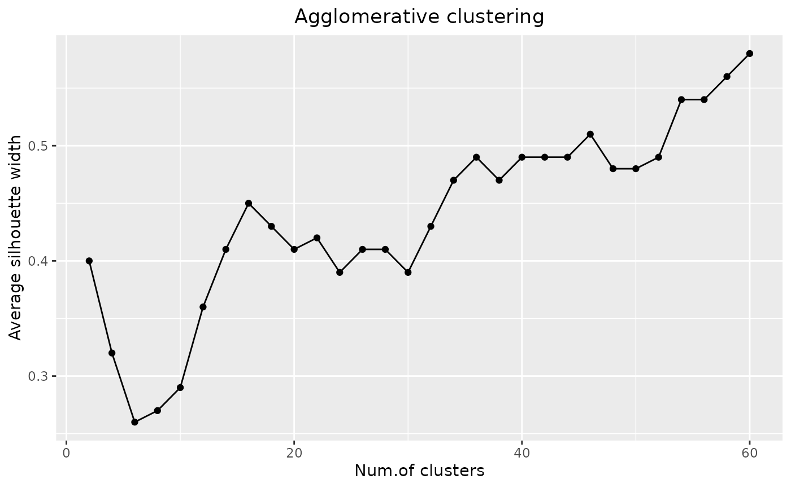
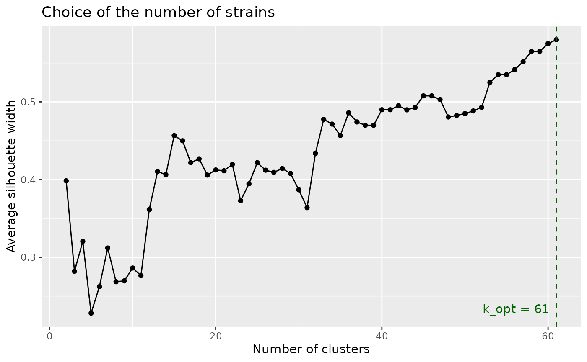
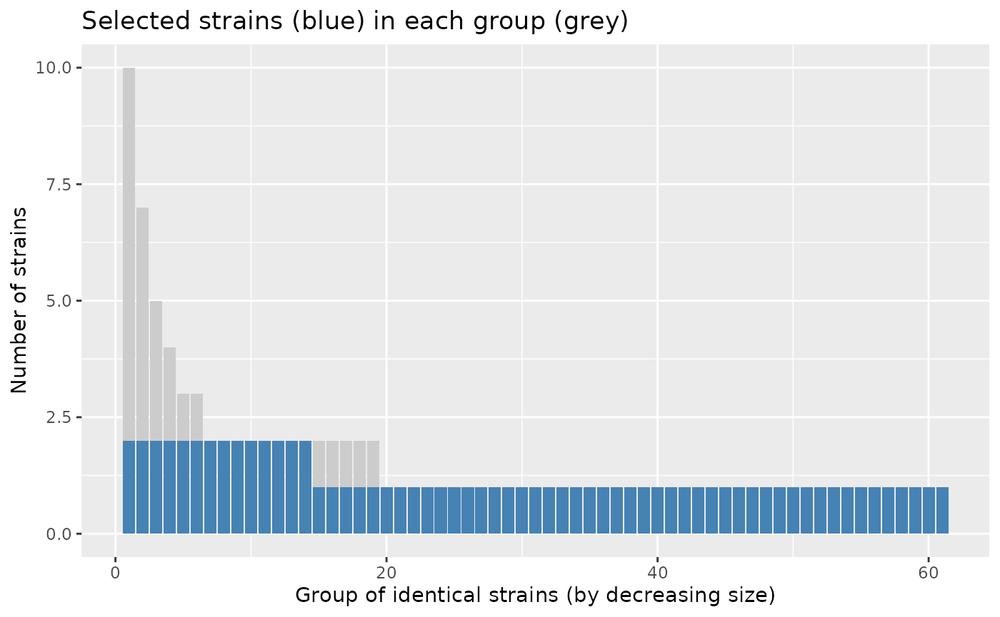
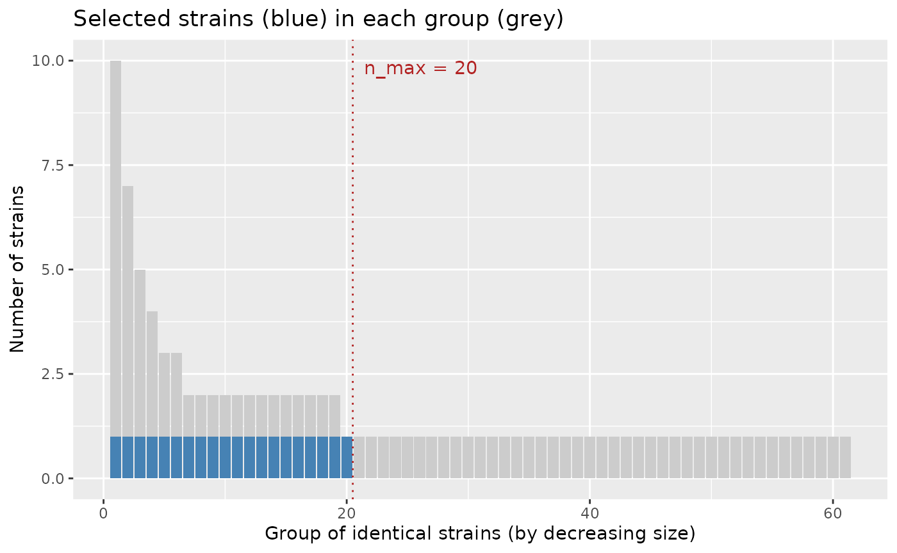
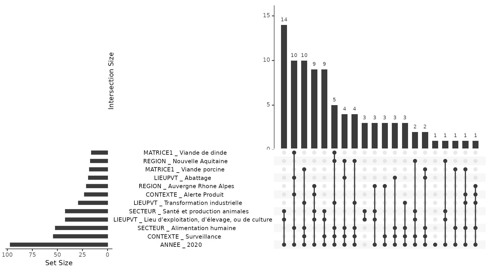

# Get started

``` r

library(strainselect)
```

## Overview

{strainselect} helps choosing which bacterial strains to sequence from a
collection described by metadata (sampling context, matrix, region,
sector, year…). It offers two complementary methods:

- the **clustering method**
  ([`assess_gower()`](https://lguillier.github.io/strainselect_package/reference/assess_gower.md),
  [`cstats_table()`](https://lguillier.github.io/strainselect_package/reference/cstats_table.md),
  [`select_silhouette()`](https://lguillier.github.io/strainselect_package/reference/select_silhouette.md))
  is suited when the number of strains that can be sequenced is limited.
  Strains are grouped into *k* clusters of similar strains and the best
  clustered strain of each cluster is selected, so that the selected
  strains are as different as possible from each other;
- the **profile method**
  ([`prepare_upset()`](https://lguillier.github.io/strainselect_package/reference/prepare_upset.md),
  [`define_profiles()`](https://lguillier.github.io/strainselect_package/reference/define_profiles.md),
  [`select_profiles()`](https://lguillier.github.io/strainselect_package/reference/select_profiles.md))
  is suited when the number of strains to sequence is not limited.
  Strains sharing exactly the same metadata are grouped and one strain
  per group is selected, so that every distinct profile — including
  unique strains — is represented.

Both methods start with
[`prepare_input()`](https://lguillier.github.io/strainselect_package/reference/prepare_input.md),
which cleans the raw table.

The examples below use `salmonella_strains`, a table of 100 *Salmonella*
strains described by 22 variables, shipped with the package. The
selection is based on 6 variables: `CONTEXTE`, `MATRICE1`, `REGION`,
`SECTEUR`, `LIEUPVT` and the year extracted from `DATE_PRELEVEMENT`.

## Example data: salmonella_strains

`salmonella_strains` is available as soon as the package is loaded. The
same table is also shipped as a CSV file (`;` separator), which shows
the expected format of an input file:
`system.file("data_test.csv", package = "strainselect")`.

``` r

str(salmonella_strains[, c("IDENTIFIANT", "CONTEXTE", "REGION", "DATE_PRELEVEMENT")])
#> 'data.frame':    100 obs. of  4 variables:
#>  $ IDENTIFIANT     : chr  "2020LSAL00151" "2020LSAL00152" "2020LSAL00163" "2020LSAL00167" ...
#>  $ CONTEXTE        : chr  "Surveillance" "Surveillance" "Surveillance" "Surveillance" ...
#>  $ REGION          : chr  "Auvergne Rhone Alpes" "Auvergne Rhone Alpes" "Nouvelle Aquitaine" "Occitanie" ...
#>  $ DATE_PRELEVEMENT: chr  "09/01/2020" "09/01/2020" "07/01/2020" "14/01/2020" ...
```

## Preparing the data: prepare_input

Before using any of the methods, the dataset must be cleaned and contain
only the metadata on which the selection is based.
[`prepare_input()`](https://lguillier.github.io/strainselect_package/reference/prepare_input.md):

- checks that strain identifiers are unique (and stops with the list of
  duplicated identifiers otherwise);
- uses the identifiers as row names;
- keeps only the selected metadata columns;
- optionally extracts the year (`ANNEE`) and/or the month (`MOIS`) from
  a date column;
- replaces missing values by `"unknown"` and converts every column to a
  factor.

Columns can be given by their names (recommended, as it is easier to
read and does not depend on the order of the columns) or by their
positions. Dates are read with `date_format`, `"%d/%m/%Y"`
(e.g. `09/01/2020`) by default; use for instance
`date_format = "%Y-%m-%d"` for dates such as `2020-01-09`. A date column
already of class `Date` is used as is.

``` r

raw_data <- salmonella_strains
prepared_data <- prepare_input(
  raw_data,
  col_select = c("CONTEXTE", "MATRICE1", "REGION", "SECTEUR", "LIEUPVT"),
  id = "IDENTIFIANT", date = "DATE_PRELEVEMENT", month = FALSE, year = TRUE
)
#> no duplicate ID
#> selected metadata: CONTEXTE, MATRICE1, REGION, SECTEUR, LIEUPVT, ANNEE
head(prepared_data)
#>                   CONTEXTE         MATRICE1               REGION
#> 2020LSAL00151 Surveillance     non spécifié Auvergne Rhone Alpes
#> 2020LSAL00152 Surveillance     non spécifié Auvergne Rhone Alpes
#> 2020LSAL00163 Surveillance Viande de canard   Nouvelle Aquitaine
#> 2020LSAL00167 Surveillance Viande de canard            Occitanie
#> 2020LSAL00176 Surveillance    Gallus gallus   Nouvelle Aquitaine
#> 2020LSAL00177 Surveillance           Dindes             Bretagne
#>                                    SECTEUR
#> 2020LSAL00151                  Eco-système
#> 2020LSAL00152                  Eco-système
#> 2020LSAL00163         Alimentation humaine
#> 2020LSAL00167         Alimentation humaine
#> 2020LSAL00176 Santé et production animales
#> 2020LSAL00177 Santé et production animales
#>                                                     LIEUPVT ANNEE
#> 2020LSAL00151                       Source/captage de l'eau  2020
#> 2020LSAL00152                       Source/captage de l'eau  2020
#> 2020LSAL00163                   Transformation industrielle  2020
#> 2020LSAL00167                   Transformation industrielle  2020
#> 2020LSAL00176 Lieu d'exploitation, d'élevage, ou de culture  2020
#> 2020LSAL00177 Lieu d'exploitation, d'élevage, ou de culture  2020
# the same with column positions
prepared_data <- prepare_input(raw_data, col_select = c(5, 8, 11, 12, 15, 22),
                               id = 1, date = 15)
#> no duplicate ID
#> selected metadata: CONTEXTE, MATRICE1, REGION, SECTEUR, LIEUPVT, ANNEE
```

## Clustering method

The clustering method uses three functions:
[`assess_gower()`](https://lguillier.github.io/strainselect_package/reference/assess_gower.md),
[`cstats_table()`](https://lguillier.github.io/strainselect_package/reference/cstats_table.md)
and
[`select_silhouette()`](https://lguillier.github.io/strainselect_package/reference/select_silhouette.md).
[`cstats_table()`](https://lguillier.github.io/strainselect_package/reference/cstats_table.md)
is optional when the number of strains to sequence is fixed in advance.

### Distances and tree: assess_gower

[`assess_gower()`](https://lguillier.github.io/strainselect_package/reference/assess_gower.md)
computes a dissimilarity matrix between strains using the Gower
distance, which is suited to categorical metadata. Weights can be given
to the metadata to adjust their importance in the clustering. A
hierarchical clustering with complete linkage is then performed on this
matrix, and the dendrogram is drawn when `graph = TRUE`.

``` r

raw_data <- salmonella_strains
prepared_data <- prepare_input(raw_data, col_select = c("CONTEXTE", "MATRICE1", "REGION", "SECTEUR", "LIEUPVT"),
                               id = "IDENTIFIANT", date = "DATE_PRELEVEMENT")
#> no duplicate ID
#> selected metadata: CONTEXTE, MATRICE1, REGION, SECTEUR, LIEUPVT, ANNEE
gower <- assess_gower(prepared_data, graph = TRUE)
```


### Choosing the number of clusters: cstats_table

[`cstats_table()`](https://lguillier.github.io/strainselect_package/reference/cstats_table.md)
computes clustering statistics (see
[`fpc::cluster.stats()`](https://rdrr.io/pkg/fpc/man/cluster.stats.html))
for an increasing number of clusters: `step`, `2 * step`, …, up to `k`.
The average silhouette width (`avg.silwidth`) is the most useful one: it
is plotted against the number of clusters, and the optimal number of
clusters is marked by a maximum or a plateau of the curve. The idea is
to test a large number of clusters without exceeding the number of
strains that can be sequenced; a larger `step` reduces the computing
time.

``` r

raw_data <- salmonella_strains
prepared_data <- prepare_input(raw_data, col_select = c("CONTEXTE", "MATRICE1", "REGION", "SECTEUR", "LIEUPVT"),
                               id = "IDENTIFIANT", date = "DATE_PRELEVEMENT")
#> no duplicate ID
#> selected metadata: CONTEXTE, MATRICE1, REGION, SECTEUR, LIEUPVT, ANNEE
gower <- assess_gower(prepared_data, graph = FALSE)
stats <- cstats_table(dist = gower$gower_dist, tree = gower$aggl.clust.c,
                      k = 60, step = 2)
#> testing 2 clusters
#> testing 4 clusters
#> testing 6 clusters
#> testing 8 clusters
#> testing 10 clusters
#> testing 12 clusters
#> testing 14 clusters
#> testing 16 clusters
#> testing 18 clusters
#> testing 20 clusters
#> testing 22 clusters
#> testing 24 clusters
#> testing 26 clusters
#> testing 28 clusters
#> testing 30 clusters
#> testing 32 clusters
#> testing 34 clusters
#> testing 36 clusters
#> testing 38 clusters
#> testing 40 clusters
#> testing 42 clusters
#> testing 44 clusters
#> testing 46 clusters
#> testing 48 clusters
#> testing 50 clusters
#> testing 52 clusters
#> testing 54 clusters
#> testing 56 clusters
#> testing 58 clusters
#> testing 60 clusters
```



With a small step (here every 2 clusters), the curve shows two plateaus.
The average silhouette width jumps to about 0.45 at 16 clusters and then
stays between 0.39 and 0.43 up to 30 clusters: **about 15 clusters** is
a first level that already captures the main structure of the
collection. It jumps again to about 0.47 at 34 clusters and stays
between 0.47 and 0.51 up to 52 clusters: **about 33 clusters** is a
second, finer level. Beyond, the curve increases up to the number of
distinct profiles (61), where every profile is isolated: with
categorical metadata, this maximum is not a natural level of grouping.
The number of strains to sequence can be chosen at one of the two
plateaus, depending on the resources available.

### Selecting the strains: select_silhouette

The last step selects one strain to sequence in each cluster. The number
of clusters `k` is either chosen from the silhouette plot or set to the
number of strains that can be sequenced. For each cluster, the strain
with the largest silhouette width — i.e. the best clustered strain — is
selected. When several strains share the largest silhouette width in a
cluster, one of them is chosen at random; use `seed` to make this choice
reproducible.

``` r

raw_data <- salmonella_strains
prepared_data <- prepare_input(raw_data, col_select = c("CONTEXTE", "MATRICE1", "REGION", "SECTEUR", "LIEUPVT"),
                               id = "IDENTIFIANT", date = "DATE_PRELEVEMENT")
#> no duplicate ID
#> selected metadata: CONTEXTE, MATRICE1, REGION, SECTEUR, LIEUPVT, ANNEE
gower <- assess_gower(prepared_data, graph = FALSE)
selection <- select_silhouette(prepared_data, dist = gower$gower_dist, k = 20,
                               seed = 1)
# the 20 strains to sequence
unique(selection$selected)
#>  [1] "2020LSAL00802" "2020LSAL00487" "2020LSAL00177" "2020LSAL00854"
#>  [5] "2020LSAL00454" "2020LSAL00720" "2020LSAL00506" "2020LSAL00550"
#>  [9] "2020LSAL00660" "2020LSAL00668" "2020LSAL00724" "2020LSAL00790"
#> [13] "2020LSAL00912" "2020LSAL00792" "2020LSAL00866" "2020LSAL00892"
#> [17] "2020LSAL01016" "2020LSAL00994" "2020LSAL01040" "2020LSAL01188"
```

## Selecting strains for a sequencing budget: select_strains

[`select_strains()`](https://lguillier.github.io/strainselect_package/reference/select_strains.md)
runs the whole clustering method in one step and answers the practical
question “*I can sequence at most `n_max` strains: which ones?*”.

1.  It computes the Gower distances and the clustering tree (as
    [`assess_gower()`](https://lguillier.github.io/strainselect_package/reference/assess_gower.md)),
    then the average silhouette width for every number of clusters from
    2 to the number of distinct profiles. The number of clusters with
    the largest average silhouette width is the **optimal number of
    clusters** `k_opt`.
2.  It selects the strains according to the budget `n_max`:
    - no budget (`n_max = NULL`): one strain per optimal cluster,
      i.e. `k_opt` strains, with the status `"optimal"`;
    - budget larger than the optimum (`n_max >= k_opt`): the `k_opt`
      optimal strains, completed up to `n_max` strains (status
      `"supplementary"`) by cutting the tree into `n_max` clusters. Use
      `fill = FALSE` to stop at the optimum. As the clusters are nested,
      each supplementary strain comes from a cluster that does not
      contain an optimal strain yet;
    - budget smaller than the optimum (`n_max < k_opt`): the tree is cut
      into `n_max` clusters and one strain is selected in each (status
      `"selected"`). The optimal groups that are not represented by any
      selected strain are listed, so that the user knows what is missed.

In each cluster, the selected strain is the one with the largest
silhouette width, i.e. the best clustered one (ties are broken at
random, use `seed` for reproducibility).

With categorical metadata and equal weights, identical strains are at
distance 0 and the optimum is often close to the number of distinct
profiles: supplementary strains then mostly have the same metadata as
already selected strains, and add replicates rather than diversity. This
is not a general rule. The weights change the Gower distances between
different strains, hence the tree, the silhouette curve and the optimum
(in the example of this vignette, a weight of 3 on `REGION` lowers the
optimum from 61 to 22 clusters), and supplementary strains can then add
new profiles. Conversely, below the optimum, the strains of a cluster
are similar but not identical. The report written by
[`report_selection()`](https://lguillier.github.io/strainselect_package/reference/report_selection.md)
gives, for the actual data, the number of supplementary strains that
have the same metadata as an already selected strain, and how much the
strains differ from the selected strain of their cluster.

`select_strains(method = "profile")` applies the same logic to the
profile method. The strains with identical metadata form groups, sorted
by decreasing size (groups of the same size in random order); one strain
per group is the optimal selection:

- budget smaller than the number of groups: one strain in each of the
  `n_max` largest groups — the most frequent profiles are favoured, and
  the smallest groups (often strains with a unique profile) are listed
  as not represented;
- budget larger than the number of groups: one strain per group, then
  supplementary strains added turn by turn — a second strain in each
  group that has one, from the largest group to the smallest, then a
  third strain, and so on.

Within a group, the strains have the same metadata and are chosen at
random (use `seed` for reproducibility).

``` r

prepared_data <- prepare_input(
  salmonella_strains,
  col_select = c("CONTEXTE", "MATRICE1", "REGION", "SECTEUR", "LIEUPVT"),
  id = "IDENTIFIANT", date = "DATE_PRELEVEMENT"
)
#> no duplicate ID
#> selected metadata: CONTEXTE, MATRICE1, REGION, SECTEUR, LIEUPVT, ANNEE
# clustering method, no budget: optimal number of strains
res <- select_strains(prepared_data, seed = 1)
res
#> Strain selection (clustering method)
#>   strains: 100 - distinct profiles: 61 
#>   optimal number of clusters (k_opt): 61 
#>   maximum number of strains (n_max): not given
#>   selected strains: 61 (optimal: 61)
plot(res)
```



``` r

# budget smaller than the optimum
res_20 <- select_strains(prepared_data, n_max = 20, seed = 1)
res_20
#> Strain selection (clustering method)
#>   strains: 100 - distinct profiles: 61 
#>   optimal number of clusters (k_opt): 61 
#>   maximum number of strains (n_max): 20 
#>   selected strains: 20 (selected: 20) 
#>   optimal groups not represented: 41 out of 61
head(res_20$table[, c("cluster", "optimal_group", "selected", "status")])
#>               cluster optimal_group selected       status
#> 2020LSAL00151       1             1    FALSE not selected
#> 2020LSAL00152       1             1    FALSE not selected
#> 2020LSAL00163       2             2    FALSE not selected
#> 2020LSAL00167       2             3    FALSE not selected
#> 2020LSAL00176       3             4    FALSE not selected
#> 2020LSAL00177       3             5     TRUE     selected
# profile method, budget larger than the number of distinct profiles
res_profile <- select_strains(prepared_data, n_max = 75, method = "profile", seed = 1)
res_profile
#> Strain selection (profile method)
#>   strains: 100 - distinct profiles: 61 
#>   groups of identical strains: 61 
#>   maximum number of strains (n_max): 75 
#>   selected strains: 75 (optimal: 61, supplementary: 14)
plot(res_profile)
```



``` r

head(res_profile$groups)
#>   group size n_selected
#> 1     1   10          2
#> 2     2    7          2
#> 3     3    5          2
#> 4     4    4          2
#> 5     5    3          2
#> 6     6    3          2
#>                                                                                                                                                    profile
#> 1                                                             Alerte Produit | Viande de dinde | Pays de la Loire | Alimentation humaine | Abattage | 2020
#> 2                     Alerte Produit | Bovins | Auvergne Rhone Alpes | Santé et production animales | Lieu d'exploitation, d'élevage, ou de culture | 2020
#> 3                                          Surveillance | Viande de dinde | Nouvelle Aquitaine | Alimentation humaine | Transformation industrielle | 2020
#> 4                                   Surveillance | Viande porcine | Provence Alpes Cote d Azur | Alimentation humaine | Transformation industrielle | 2020
#> 5 Programmes de contrôle et d'éradication | Gallus gallus | Bretagne | Santé et production animales | Lieu d'exploitation, d'élevage, ou de culture | 2020
#> 6                                                            Surveillance | Viande de canard | Nouvelle Aquitaine | Alimentation humaine | Abattage | 2020
# profile method, budget smaller than the number of distinct profiles:
# one strain in each of the 20 largest groups
res_profile_20 <- select_strains(prepared_data, n_max = 20, method = "profile", seed = 1)
plot(res_profile_20)
```



### Exporting the result: export_selection

[`export_selection()`](https://lguillier.github.io/strainselect_package/reference/export_selection.md)
returns — and optionally writes to a CSV file — the original metadata
table with the columns added by
[`select_strains()`](https://lguillier.github.io/strainselect_package/reference/select_strains.md).
The file can be opened in a spreadsheet and filtered on `selected` to
get the list of strains to sequence.

``` r

prepared_data <- prepare_input(
  salmonella_strains,
  col_select = c("CONTEXTE", "MATRICE1", "REGION", "SECTEUR", "LIEUPVT"),
  id = "IDENTIFIANT", date = "DATE_PRELEVEMENT"
)
#> no duplicate ID
#> selected metadata: CONTEXTE, MATRICE1, REGION, SECTEUR, LIEUPVT, ANNEE
res <- select_strains(prepared_data, n_max = 20, seed = 1)
selection <- export_selection(res, data = salmonella_strains, id = "IDENTIFIANT")
# the strains to sequence, with all their metadata
head(selection[selection$selected, c("IDENTIFIANT", "REGION", "status")])
#>      IDENTIFIANT                     REGION   status
#> 6  2020LSAL00177                   Bretagne selected
#> 14 2020LSAL00454            Hauts de France selected
#> 20 2020LSAL00487              Ile de France selected
#> 22 2020LSAL00506                       <NA> selected
#> 27 2020LSAL00549 Provence Alpes Cote d Azur selected
#> 36 2020LSAL00660                  Occitanie selected
# write the table to a CSV file
export_selection(res, data = salmonella_strains, id = "IDENTIFIANT",
                 file = file.path(tempdir(), "selection.csv"))
#> selection written to /tmp/RtmpUbHB2w/selection.csv
```

### Reporting: report_selection

[`report_selection()`](https://lguillier.github.io/strainselect_package/reference/report_selection.md)
writes an HTML report of the selection: the parameters, the silhouette
curve with the optimum and the budget, the list of the selected strains,
the optimal groups that are not represented and the size of each
cluster. Together with the CSV file of
[`export_selection()`](https://lguillier.github.io/strainselect_package/reference/export_selection.md),
it documents the choice of the strains to sequence.

``` r

prepared_data <- prepare_input(
  salmonella_strains,
  col_select = c("CONTEXTE", "MATRICE1", "REGION", "SECTEUR", "LIEUPVT"),
  id = "IDENTIFIANT", date = "DATE_PRELEVEMENT"
)
#> no duplicate ID
#> selected metadata: CONTEXTE, MATRICE1, REGION, SECTEUR, LIEUPVT, ANNEE
res <- select_strains(prepared_data, n_max = 20, seed = 1)
if (requireNamespace("rmarkdown", quietly = TRUE) && rmarkdown::pandoc_available()) {
  report_selection(res, file = file.path(tempdir(), "selection.html"),
                   data = salmonella_strains, id = "IDENTIFIANT")
}
#> selection written to /tmp/RtmpUbHB2w/selection.csv
#> report written to /tmp/RtmpUbHB2w/selection.html
```

## Profile method

This method groups strains that are strictly identical for all the
selected metadata, and selects one strain per group. Unlike the
clustering method, all strains of a group are identical, and strains
that are similar to no other strain form a group on their own. It uses
three functions:
[`prepare_upset()`](https://lguillier.github.io/strainselect_package/reference/prepare_upset.md),
[`define_profiles()`](https://lguillier.github.io/strainselect_package/reference/define_profiles.md)
and
[`select_profiles()`](https://lguillier.github.io/strainselect_package/reference/select_profiles.md).

### Binary table: prepare_upset

[`prepare_upset()`](https://lguillier.github.io/strainselect_package/reference/prepare_upset.md)
creates a binary table from the prepared data: there is one column per
modality of each metadata (named `<metadata> _ <modality>`), filled with
1 if the strain has this modality and 0 otherwise.

``` r

raw_data <- salmonella_strains
prepared_data <- prepare_input(raw_data, col_select = c("CONTEXTE", "MATRICE1", "REGION", "SECTEUR", "LIEUPVT"),
                               id = "IDENTIFIANT", date = "DATE_PRELEVEMENT")
#> no duplicate ID
#> selected metadata: CONTEXTE, MATRICE1, REGION, SECTEUR, LIEUPVT, ANNEE
upset_data <- prepare_upset(prepared_data)
upset_data[1:5, 1:4]
#>               CONTEXTE _ Surveillance CONTEXTE _ Alerte Produit
#> 2020LSAL00151                       1                         0
#> 2020LSAL00152                       1                         0
#> 2020LSAL00163                       1                         0
#> 2020LSAL00167                       1                         0
#> 2020LSAL00176                       1                         0
#>               CONTEXTE _ Programmes de contrôle et d'éradication
#> 2020LSAL00151                                                  0
#> 2020LSAL00152                                                  0
#> 2020LSAL00163                                                  0
#> 2020LSAL00167                                                  0
#> 2020LSAL00176                                                  0
#>               CONTEXTE _ Etudes cliniques
#> 2020LSAL00151                           0
#> 2020LSAL00152                           0
#> 2020LSAL00163                           0
#> 2020LSAL00167                           0
#> 2020LSAL00176                           0
```

The binary table can be used to visualise the groups of identical
strains in an UpSet plot, for instance with the {UpSetR} package:

``` r

# the 12 most frequent modalities
UpSetR::upset(upset_data, nsets = 12, order.by = "freq", nintersects = 20,
              mb.ratio = c(0.55, 0.45), text.scale = 1.1)
#> Warning: `aes_string()` was deprecated in ggplot2 3.0.0.
#> ℹ Please use tidy evaluation idioms with `aes()`.
#> ℹ See also `vignette("ggplot2-in-packages")` for more information.
#> ℹ The deprecated feature was likely used in the UpSetR package.
#>   Please report the issue at <https://github.com/hms-dbmi/UpSetR/issues>.
#> This warning is displayed once per session.
#> Call `lifecycle::last_lifecycle_warnings()` to see where this warning was
#> generated.
#> Warning: Using `size` aesthetic for lines was deprecated in ggplot2 3.4.0.
#> ℹ Please use `linewidth` instead.
#> ℹ The deprecated feature was likely used in the UpSetR package.
#>   Please report the issue at <https://github.com/hms-dbmi/UpSetR/issues>.
#> This warning is displayed once per session.
#> Call `lifecycle::last_lifecycle_warnings()` to see where this warning was
#> generated.
#> Warning: The `size` argument of `element_line()` is deprecated as of ggplot2 3.4.0.
#> ℹ Please use the `linewidth` argument instead.
#> ℹ The deprecated feature was likely used in the UpSetR package.
#>   Please report the issue at <https://github.com/hms-dbmi/UpSetR/issues>.
#> This warning is displayed once per session.
#> Call `lifecycle::last_lifecycle_warnings()` to see where this warning was
#> generated.
```



### Groups of identical strains: define_profiles

[`define_profiles()`](https://lguillier.github.io/strainselect_package/reference/define_profiles.md)
builds a profile for each strain by concatenating the columns of the
binary table. Strains with identical profiles are put in the same group;
a profile shared by no other strain forms a group with a single strain.

``` r

raw_data <- salmonella_strains
prepared_data <- prepare_input(raw_data, col_select = c("CONTEXTE", "MATRICE1", "REGION", "SECTEUR", "LIEUPVT"),
                               id = "IDENTIFIANT", date = "DATE_PRELEVEMENT")
#> no duplicate ID
#> selected metadata: CONTEXTE, MATRICE1, REGION, SECTEUR, LIEUPVT, ANNEE
upset_data <- prepare_upset(prepared_data)
upset_profiles <- define_profiles(upset_data)
# number of distinct profiles
max(upset_profiles$group)
#> [1] 61
```

### Selecting the strains: select_profiles

Finally,
[`select_profiles()`](https://lguillier.github.io/strainselect_package/reference/select_profiles.md)
selects one strain per group. A group containing a single strain gets
this strain; since all strains of a larger group are identical, one of
them is chosen at random. Use `seed` to make the selection reproducible.

``` r

raw_data <- salmonella_strains
prepared_data <- prepare_input(raw_data, col_select = c("CONTEXTE", "MATRICE1", "REGION", "SECTEUR", "LIEUPVT"),
                               id = "IDENTIFIANT", date = "DATE_PRELEVEMENT")
#> no duplicate ID
#> selected metadata: CONTEXTE, MATRICE1, REGION, SECTEUR, LIEUPVT, ANNEE
upset_profiles <- define_profiles(prepare_upset(prepared_data))
selection <- select_profiles(upset_profiles, prepared_data, seed = 1)
# one strain per distinct profile
length(unique(selection$selected))
#> [1] 61
```
